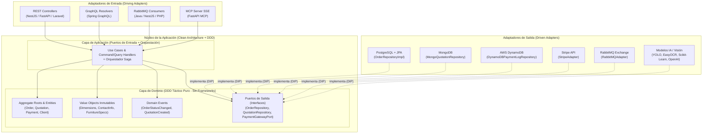

# Arquitectura Hexagonal, Domain-Driven Design (DDD) y Clean Architecture en el Sistema "Carpintería El Roble"

Este documento detalla cómo se diseñó e implementó la combinación de **Domain-Driven Design (DDD)**, **Clean Architecture** y **Arquitectura Hexagonal (Puertos y Adaptadores)** en el ecosistema de microservicios de **Carpintería El Roble**, especificando **cómo se aplica** en el código fuente real y **por qué se eligió cada enfoque arquitectónico según la naturaleza de cada framework y lenguaje**.

---

## 1. Fundamento Conceptual: ¿Cómo se complementan DDD, Clean Architecture y Arquitectura Hexagonal?

Aunque suelen mencionarse por separado, en la ingeniería de software moderna estos tres patrones forman una **arquitectura unificada (Clean/Hexagonal DDD)**:

1. **Domain-Driven Design (DDD — Eric Evans):** Define **qué va en el corazón del software**. Modela el negocio real de la carpintería mediante *Bounded Contexts* (Contextos Delimitados), *Aggregates* (Agregados), *Entities* (Entidades), *Value Objects* (Objetos de Valor), *Domain Events* (Eventos de Dominio) y un *Lenguaje Ubicuo*.
2. **Clean Architecture (Robert C. Martin):** Define **la Regla de Dependencia en anillos concéntricos**. Las capas externas (`Infrastructure / Frameworks`) dependen de las capas internas (`Application` $\rightarrow$ `Domain`), pero **el Dominio jamás conoce ni importa nada de las capas externas** (ni bases de datos, ni frameworks web, ni librerías de terceros).
3. **Arquitectura Hexagonal / Puertos y Adaptadores (Alistair Cockburn):** Define **cómo se conecta el núcleo con el mundo exterior** mediante:
   * **Puertos de Entrada (Inbound/Driving Ports):** Casos de Uso y Command/Query Handlers que exponen qué puede hacer el sistema.
   * **Adaptadores Primarios (Inbound/Driving Adapters):** Controladores REST, Resolvers GraphQL, Consumidores RabbitMQ y Servidores MCP que reciben peticiones externas e invocan los Puertos de Entrada.
   * **Puertos de Salida (Outbound/Driven Ports):** Interfaces (`Repository`, `GatewayPort`, `EventPublisher`) definidas dentro del Dominio/Aplicación que especifican qué necesita el núcleo del exterior.
   * **Adaptadores Secundarios (Outbound/Driven Adapters):** Implementaciones concretas para PostgreSQL, MongoDB, DynamoDB, Redis, Stripe, S3, RabbitMQ, OpenAI/Gemini/YOLO y DomPDF.



---

## 2. Diseño Estratégico DDD: Los 4 Bounded Contexts del Sistema

Siguiendo el **Diseño Estratégico de DDD**, el dominio de **Carpintería El Roble** se particionó en **4 Contextos Delimitados (Bounded Contexts)** independientes, cada uno desplegado como un microservicio autónomo con su propia base de datos (**Database-per-Service**):

| Bounded Context (Microservicio) | Subdominio DDD | Framework / Lenguaje | Base de Datos Propia | Responsabilidad de Negocio |
| :--- | :--- | :--- | :--- | :--- |
| **1. Operaciones y Taller (`Backend1-Java-Negocio`)** | **Core Domain** (Dominio Principal) | Java 17 + Spring Boot 3.4 | PostgreSQL (`carpinteria_business`) | Gestión de Clientes, Carpinteros, Pedidos de Producción, Pasos de Taller, Inventario de Madera e Insumos, y Programación de Entregas. |
| **2. Comercial, Pagos y Gateway (`Backend2-NestJS-Gateway`)** | **Core / Supporting Domain** | TypeScript 5 + NestJS 10 | MongoDB + AWS DynamoDB + Redis | Cotizaciones a medida, Catálogo Marketplace, Procesamiento de Pagos, Orquestación Saga, Identidad SSO (JWT/Google OIDC) y WebSockets en tiempo real. |
| **3. Inteligencia Artificial y Estimación (`Backend3-Python-IA-MCP`)** | **Core / Generic AI Domain** | Python 3.11 + FastAPI | Memoria Vectorial / Modelos `.joblib` | Estimación predictiva de costos y tiempos (Regresión ML), Visión por Computadora (YOLO + OCR + Gemini), Clustering K-Means de Clientes, Text-to-SQL y Servidor MCP. |
| **4. Facturación y Recibos (`Backend4-PHP-Recibos`)** | **Supporting Domain** | PHP 8.2 + Laravel 11 | SQLite / MySQL (`invoices`) | Emisión idempotente de recibos contables, numeración secuencial `FAC-YYYYMMDD-XXXX`, renderizado de PDFs (DomPDF) y disparo de webhooks a n8n. |

---

## 3. Detalle por Framework: ¿Cómo se implementó y POR QUÉ se usó en cada Microservicio?

---

### 3.1 Backend 1: Java 17 + Spring Boot 3.4 (`Backend1-Java-Negocio`)
#### Patrón Aplicado: **DDD Táctico Estricto + Clean Architecture + Puertos y Adaptadores**

#### A. ¿Por qué se eligió esta arquitectura específicamente para Java / Spring Boot?
1. **Protección del *Core Domain* frente al acoplamiento con JPA/Hibernate:**
   En proyectos tradicionales con Spring Boot, el error más común es anotar las clases de negocio con `@Entity`, `@Table`, `@OneToMany` de Jakarta Persistence y usarlas directamente en los controladores. Eso destruye el encapsulamiento (obliga a tener constructores vacíos y `setters` públicos) y acopla las reglas de negocio al esquema relacional de PostgreSQL.
2. **Aislamiento Total del Dominio (Pure Java POJOs):**
   Al aplicar **DDD + Clean Architecture** en Java, todo el paquete `com.carpinteria.business.domain` está escrito en **Java puro**, sin una sola importación de `org.springframework.*` ni `jakarta.persistence.*`.
3. **Separación entre Modelo de Dominio Rico (`Order`) y Modelo de Persistencia (`OrderEntity`):**
   * El modelo de dominio ([`Order.java`](../Backend1-Java-Negocio/src/main/java/com/carpinteria/business/domain/order/model/Order.java)) protege las invariantes del taller (máquina de estados `PENDING` $\rightarrow$ `IN_PRODUCTION` $\rightarrow$ `READY` $\rightarrow$ `DELIVERED`, generación automática de pasos de producción con `ensureDefaultSteps()`, cálculo de subtotales).
   * La infraestructura ([`OrderEntity.java`](../Backend1-Java-Negocio/src/main/java/com/carpinteria/business/infrastructure/persistence/order/OrderEntity.java) y [`OrderMapper.java`](../Backend1-Java-Negocio/src/main/java/com/carpinteria/business/infrastructure/persistence/order/OrderMapper.java)) se encarga exclusivamente de traducir ese agregado rico a tablas SQL en PostgreSQL.

#### B. Estructura de Capas en `Backend1-Java-Negocio`

| Capa Arquitectónica | Componentes Reales en el Código | Función Específica |
| :--- | :--- | :--- |
| **1. Dominio (`domain/`)** | • **Aggregate Roots:** [`Order`](../Backend1-Java-Negocio/src/main/java/com/carpinteria/business/domain/order/model/Order.java), [`Client`](../Backend1-Java-Negocio/src/main/java/com/carpinteria/business/domain/client/model/Client.java), [`Carpenter`](../Backend1-Java-Negocio/src/main/java/com/carpinteria/business/domain/carpenter/model/Carpenter.java), [`Material`](../Backend1-Java-Negocio/src/main/java/com/carpinteria/business/domain/material/model/Material.java), [`DeliverySchedule`](../Backend1-Java-Negocio/src/main/java/com/carpinteria/business/domain/delivery/model/DeliverySchedule.java)<br>• **Entidades Internas:** [`OrderItem`](../Backend1-Java-Negocio/src/main/java/com/carpinteria/business/domain/order/model/OrderItem.java), [`ProductionStep`](../Backend1-Java-Negocio/src/main/java/com/carpinteria/business/domain/order/model/ProductionStep.java)<br>• **Value Objects (`record`):** [`Dimensions`](../Backend1-Java-Negocio/src/main/java/com/carpinteria/business/domain/order/model/Dimensions.java), [`ContactInfo`](../Backend1-Java-Negocio/src/main/java/com/carpinteria/business/domain/client/model/ContactInfo.java)<br>• **Domain Events:** [`OrderStatusChangedEvent`](../Backend1-Java-Negocio/src/main/java/com/carpinteria/business/domain/order/event/OrderStatusChangedEvent.java), [`LowStockAlertEvent`](../Backend1-Java-Negocio/src/main/java/com/carpinteria/business/domain/material/event/LowStockAlertEvent.java)<br>• **Puertos de Salida:** [`OrderRepository`](../Backend1-Java-Negocio/src/main/java/com/carpinteria/business/domain/order/repository/OrderRepository.java), [`ClientRepository`](../Backend1-Java-Negocio/src/main/java/com/carpinteria/business/domain/client/repository/ClientRepository.java), [`DomainEventPublisher`](../Backend1-Java-Negocio/src/main/java/com/carpinteria/business/domain/order/repository/DomainEventPublisher.java) | Encapsula el 100% de las reglas del negocio maderero: validación de transiciones de estado, cálculo de volumen en $m^3$, alertas de stock mínimo y segmentación de clientes (`REGULAR`, `VIP`, `WHOLESALE`). |
| **2. Aplicación (`application/`)** | • **Casos de Uso:** [`CreateOrderUseCase`](../Backend1-Java-Negocio/src/main/java/com/carpinteria/business/application/order/CreateOrderUseCase.java), [`UpdateOrderStatusUseCase`](../Backend1-Java-Negocio/src/main/java/com/carpinteria/business/application/order/UpdateOrderStatusUseCase.java), [`RegisterClientUseCase`](../Backend1-Java-Negocio/src/main/java/com/carpinteria/business/application/client/RegisterClientUseCase.java), [`RegisterCarpenterUseCase`](../Backend1-Java-Negocio/src/main/java/com/carpinteria/business/application/carpenter/RegisterCarpenterUseCase.java), [`ScheduleDeliveryUseCase`](../Backend1-Java-Negocio/src/main/java/com/carpinteria/business/application/delivery/ScheduleDeliveryUseCase.java)<br>• **Commands / DTOs:** `CreateOrderCommand`, `OrderResponse` | Orquesta transacciones `@Transactional`, coordina repositorios de dominio y publica los eventos generados por los agregados (`order.pullDomainEvents()`). |
| **3. Infraestructura (`infrastructure/`)** | • **Adaptadores de Entrada:** [`OrderResolver`](../Backend1-Java-Negocio/src/main/java/com/carpinteria/business/infrastructure/graphql/OrderResolver.java) (GraphQL), [`QuotationApprovedConsumer`](../Backend1-Java-Negocio/src/main/java/com/carpinteria/business/infrastructure/messaging/QuotationApprovedConsumer.java) (RabbitMQ)<br>• **Adaptadores de Salida:** [`OrderRepositoryImpl`](../Backend1-Java-Negocio/src/main/java/com/carpinteria/business/infrastructure/persistence/order/OrderRepositoryImpl.java) (PostgreSQL JPA), [`RabbitMQPublisher`](../Backend1-Java-Negocio/src/main/java/com/carpinteria/business/infrastructure/messaging/RabbitMQPublisher.java) (AMQP) | Conecta GraphQL, PostgreSQL y RabbitMQ con los puertos del dominio mediante Inyección de Dependencias de Spring. |

---

### 3.2 Backend 2: TypeScript + NestJS 10 (`Backend2-NestJS-Gateway`)
#### Patrón Aplicado: **Arquitectura Hexagonal Explícita (`adapters/inbound` y `adapters/outbound`) + DDD + CQRS + Saga Orchestrator**

#### A. ¿Por qué se eligió esta arquitectura específicamente para NestJS?
1. **Naturaleza Multiprotocolo y Políglota de Persistencia:**
   El microservicio en NestJS cumple un rol dual: es el **API Gateway** del sistema y es el dueño de los contextos de **Cotizaciones, Marketplace y Pagos**. Por ello, debe hablar simultáneamente con **7 tecnologías externas distintas**:
   * **MongoDB** (documentos flexibles de cotizaciones y catálogo de muebles).
   * **AWS DynamoDB** (bitácora inmutable de alta escritura `payment_logs` con TTL de 90 días).
   * **Redis** (usuarios SSO, caché y pub/sub).
   * **Stripe API** (pasarela de cobros con tarjeta).
   * **AWS S3** (almacenamiento de fotografías de muebles).
   * **RabbitMQ** (bus de eventos `carpinteria.events`).
   * **FastAPI IA** (estimación de precios por visión/ML).
2. **Inversión de Dependencias Nativa con Tokens (`Symbol`) en NestJS:**
   NestJS posee un contenedor de Inyección de Dependencias inspirado en Angular/Spring que permite registrar **Puertos de Salida mediante `Symbol`** en [`app.module.ts`](../Backend2-NestJS-Gateway/src/app.module.ts) y asociarlos a **Adaptadores Secundarios intercambiables**:
   ```typescript
   { provide: QUOTATION_REPOSITORY, useClass: MongoQuotationRepository },
   { provide: PAYMENT_LOG_REPOSITORY, useClass: DynamoDBPaymentLogRepository },
   { provide: PAYMENT_GATEWAY, useClass: StripeAdapter },
   ```
   Gracias a la **Arquitectura Hexagonal**, si en una demostración o entorno local no hay conexión a AWS DynamoDB o Stripe, los adaptadores hacen *fallback* transparente sin que [`ProcessPaymentHandler`](../Backend2-NestJS-Gateway/src/application/payment/commands/process-payment.handler.ts) ni [`MarketplaceCheckoutSaga`](../Backend2-NestJS-Gateway/src/application/saga/marketplace-checkout.saga.ts) se enteren.

#### B. Estructura Hexagonal en `Backend2-NestJS-Gateway`

| Elemento Hexagonal / DDD | Archivos Reales en `Backend2-NestJS-Gateway/src` | Responsabilidad |
| :--- | :--- | :--- |
| **Dominio DDD (`domain/`)** | • **Entidades:** [`Quotation`](../Backend2-NestJS-Gateway/src/domain/quotation/entities/quotation.entity.ts), [`QuotationItem`](../Backend2-NestJS-Gateway/src/domain/quotation/entities/quotation-item.entity.ts), [`Payment`](../Backend2-NestJS-Gateway/src/domain/payment/entities/payment.entity.ts)<br>• **Value Objects:** [`QuotationId`](../Backend2-NestJS-Gateway/src/domain/quotation/value-objects/quotation-id.vo.ts), [`FurnitureSpecs`](../Backend2-NestJS-Gateway/src/domain/quotation/value-objects/furniture-specs.vo.ts), [`PaymentId`](../Backend2-NestJS-Gateway/src/domain/payment/value-objects/payment-id.vo.ts), [`TransactionLog`](../Backend2-NestJS-Gateway/src/domain/payment/value-objects/transaction-log.vo.ts)<br>• **Eventos:** [`QuotationCreatedEvent`](../Backend2-NestJS-Gateway/src/domain/quotation/events/quotation-created.event.ts), [`PaymentCompletedEvent`](../Backend2-NestJS-Gateway/src/domain/payment/events/payment-completed.event.ts)<br>• **Puertos de Repositorio:** [`QuotationRepository`](../Backend2-NestJS-Gateway/src/domain/quotation/repositories/quotation.repository.ts), [`PaymentLogRepository`](../Backend2-NestJS-Gateway/src/domain/payment/repositories/payment-log.repository.ts) | Modela la negociación de cotizaciones (`DRAFT` $\rightarrow$ `QUOTED` $\rightarrow$ `APPROVED` / `REJECTED`), contraofertas del cliente y el ciclo de vida del pago (`PENDING` $\rightarrow$ `COMPLETED` / `FAILED`). |
| **Aplicación: CQRS + Saga (`application/`)** | • **Commands:** [`CreateQuotationHandler`](../Backend2-NestJS-Gateway/src/application/quotation/commands/create-quotation.handler.ts), [`ProcessPaymentHandler`](../Backend2-NestJS-Gateway/src/application/payment/commands/process-payment.handler.ts)<br>• **Queries:** [`GetQuotationHandler`](../Backend2-NestJS-Gateway/src/application/quotation/queries/get-quotation.handler.ts)<br>• **Orquestador Saga:** [`MarketplaceCheckoutSaga`](../Backend2-NestJS-Gateway/src/application/saga/marketplace-checkout.saga.ts)<br>• **Puertos Externos:** [`PaymentGatewayPort`](../Backend2-NestJS-Gateway/src/application/payment/ports/payment-gateway.port.ts), [`EventPublisherPort`](../Backend2-NestJS-Gateway/src/application/quotation/ports/event-publisher.port.ts) | Separa lecturas (`queries`) de escrituras (`commands` — **CQRS**) y coordina transacciones distribuidas con compensaciones LIFO mediante el **Patrón Saga**. |
| **Adaptadores de Entrada (`infrastructure/adapters/inbound/`)** | • [`QuotationController`](../Backend2-NestJS-Gateway/src/infrastructure/adapters/inbound/rest/quotation.controller.ts)<br>• [`PaymentController`](../Backend2-NestJS-Gateway/src/infrastructure/adapters/inbound/rest/payment.controller.ts)<br>• [`ProductController`](../Backend2-NestJS-Gateway/src/infrastructure/adapters/inbound/rest/product.controller.ts)<br>• [`UploadsController`](../Backend2-NestJS-Gateway/src/infrastructure/adapters/inbound/rest/uploads.controller.ts)<br>• [`OrderEventsGateway`](../Backend2-NestJS-Gateway/src/websocket/order-events.gateway.ts) (WebSockets) | Validan DTOs de entrada con `class-validator`, verifican JWT/RBAC (`JwtAuthGuard`, `RolesGuard`) e invocan a los Handlers/Sagas de la capa de aplicación. |
| **Adaptadores de Salida (`infrastructure/adapters/outbound/`)** | • **Persistencia:** [`MongoQuotationRepository`](../Backend2-NestJS-Gateway/src/infrastructure/adapters/outbound/persistence/mongo-quotation.repository.ts), [`MongoProductRepository`](../Backend2-NestJS-Gateway/src/infrastructure/adapters/outbound/persistence/mongo-product.repository.ts), [`DynamoDBPaymentLogRepository`](../Backend2-NestJS-Gateway/src/infrastructure/adapters/outbound/persistence/dynamodb-payment-log.repository.ts)<br>• **Externos:** [`StripeAdapter`](../Backend2-NestJS-Gateway/src/infrastructure/adapters/outbound/external/stripe.adapter.ts), [`AiServiceAdapter`](../Backend2-NestJS-Gateway/src/infrastructure/adapters/outbound/external/ai-service.adapter.ts)<br>• **Mensajería:** [`RabbitMQAdapter`](../Backend2-NestJS-Gateway/src/infrastructure/adapters/outbound/messaging/rabbitmq.adapter.ts) | Implementan los puertos de salida conectándose a MongoDB, AWS DynamoDB, Stripe, FastAPI y RabbitMQ con soporte de *fallback* en memoria. |

---

### 3.3 Backend 3: Python 3.11 + FastAPI (`Backend3-Python-IA-MCP`)
#### Patrón Aplicado: **Clean Architecture + Arquitectura Hexagonal Multiprotocolo (REST + MCP Server)**

#### A. ¿Por qué se eligió esta arquitectura específicamente para Python / FastAPI?
1. **Doble Protocolo de Exposición (REST HTTP + Model Context Protocol MCP):**
   El microservicio de Inteligencia Artificial debe atender **dos tipos de consumidores totalmente distintos** ejecutando exactamente la misma lógica de negocio:
   * Los Frontends Web/Móvil y el Gateway consumen endpoints **REST HTTP** ([`ai_router.py`](../Backend3-Python-IA-MCP/app/adapters/rest/ai_router.py)).
   * Los Agentes de IA y clientes compatibles con el estándar **Model Context Protocol (MCP)** consumen **Tools, Resources y Prompts** vía JSON-RPC/SSE ([`server.py`](../Backend3-Python-IA-MCP/app/mcp/server.py), [`tools_impl.py`](../Backend3-Python-IA-MCP/app/mcp/tools/tools_impl.py)).
   Gracias a la **Arquitectura Hexagonal**, tanto `adapters/rest/` como `mcp/tools/` son simplemente **Adaptadores Primarios (Inbound)** que llaman a los mismos Casos de Uso en `app/application/`.
2. **Desacoplamiento de Librerías Pesadas y Volátiles de IA/ML:**
   En Python, librerías como `ultralytics` (YOLOv8), `easyocr`, `scikit-learn`, `openai` o `google-generativeai` cambian de API con frecuencia o pueden requerir GPU/red externa. Al confinar todas esas librerías en `app/infrastructure/ml` y `app/infrastructure/vision`, el dominio (`app/domain/furniture`, `app/domain/pricing`) y los casos de uso (`app/application/estimate_furniture.py`) permanecen puros, rápidos de testear y capaces de operar con pipelines híbridos (fusión de YOLO + OCR + Gemini Vision en [`fusion.py`](../Backend3-Python-IA-MCP/app/infrastructure/vision/fusion.py)).

#### B. Estructura de Capas en `Backend3-Python-IA-MCP`

| Capa Arquitectónica | Módulos Reales en `Backend3-Python-IA-MCP/app` | Responsabilidad |
| :--- | :--- | :--- |
| **1. Dominio (`domain/`)** | • [`domain/furniture/models.py`](../Backend3-Python-IA-MCP/app/domain/furniture/models.py)<br>• [`domain/pricing/models.py`](../Backend3-Python-IA-MCP/app/domain/pricing/models.py) | Define las entidades y reglas de negocio para especificaciones de muebles, factores de complejidad por tipo de madera (`ROBLE`, `MARA`, `TAJIBO`, `PINO`) y estructuras de desglose de costos. |
| **2. Aplicación (`application/`)** | • [`estimate_furniture.py`](../Backend3-Python-IA-MCP/app/application/estimate_furniture.py)<br>• [`cluster_clients.py`](../Backend3-Python-IA-MCP/app/application/cluster_clients.py)<br>• [`check_delivery.py`](../Backend3-Python-IA-MCP/app/application/check_delivery.py)<br>• [`generate_report.py`](../Backend3-Python-IA-MCP/app/application/generate_report.py)<br>• [`agent.py`](../Backend3-Python-IA-MCP/app/application/agent.py) y [`agent_llm.py`](../Backend3-Python-IA-MCP/app/application/agent_llm.py) | Casos de uso puros: estimación combinando Visión + Regresión ML, segmentación RFM con K-Means, detección de colisiones de entregas, generación segura de reportes SQL (`SELECT`-only) y agente conversacional con memoria. |
| **3. Adaptadores de Entrada (`adapters/rest/` y `mcp/`)** | • **REST Inbound:** [`adapters/rest/ai_router.py`](../Backend3-Python-IA-MCP/app/adapters/rest/ai_router.py)<br>• **MCP Inbound:** [`mcp/server.py`](../Backend3-Python-IA-MCP/app/mcp/server.py), [`mcp/tools/tools_impl.py`](../Backend3-Python-IA-MCP/app/mcp/tools/tools_impl.py), [`mcp/resources/resources_impl.py`](../Backend3-Python-IA-MCP/app/mcp/resources/resources_impl.py), [`mcp/prompts/prompts_impl.py`](../Backend3-Python-IA-MCP/app/mcp/prompts/prompts_impl.py) | Exponen los casos de uso simultáneamente como API REST con validación Pydantic y como servidor **MCP (Tools, Resources, Prompts)**. |
| **4. Infraestructura (`infrastructure/`)** | • **ML:** [`price_regressor.py`](../Backend3-Python-IA-MCP/app/infrastructure/ml/price_regressor.py), [`client_clusterer.py`](../Backend3-Python-IA-MCP/app/infrastructure/ml/client_clusterer.py)<br>• **Visión:** [`yolo_classifier.py`](../Backend3-Python-IA-MCP/app/infrastructure/vision/yolo_classifier.py), [`ocr_adapter.py`](../Backend3-Python-IA-MCP/app/infrastructure/vision/ocr_adapter.py), [`gemini_vision.py`](../Backend3-Python-IA-MCP/app/infrastructure/vision/gemini_vision.py), [`fusion.py`](../Backend3-Python-IA-MCP/app/infrastructure/vision/fusion.py)<br>• **Clientes Externos:** [`business_client.py`](../Backend3-Python-IA-MCP/app/infrastructure/http/business_client.py), [`postgres_readonly.py`](../Backend3-Python-IA-MCP/app/infrastructure/db/postgres_readonly.py) | Adaptadores secundarios para modelos Scikit-Learn, redes neuronales de visión (YOLO/EasyOCR/Gemini), cliente GraphQL hacia Java y conexión SQL de solo lectura hacia PostgreSQL. |

---

### 3.4 Backend 4: PHP 8.2 + Laravel 11 (`Backend4-PHP-Recibos`)
#### Patrón Aplicado: **Service-Layer Architecture + Adaptadores de Entrada Duales (Event-Driven AMQP + HTTP REST)**

#### A. ¿Por qué se eligió esta arquitectura pragmática en PHP / Laravel?
1. **Adecuación al Subdominio de Soporte (*Supporting Subdomain* en DDD):**
   Una regla fundamental de **DDD Estratégico** es **no aplicar la misma complejidad táctica en todos los subdominios**. Mientras que *Pedidos de Taller* (Java) y *Cotizaciones/Pagos/Saga* (NestJS) son el *Core Domain* con máquinas de estados complejas, *Emisión de Recibos PDF* (PHP Laravel) es un **Supporting Subdomain** cuyo flujo es lineal, determinista e inmutable: recibir un pago confirmado, garantizar idempotencia financiera, generar el número secuencial `FAC-YYYYMMDD-XXXX`, renderizar el PDF y notificar a n8n.
2. **Aprovechamiento de Eloquent + Capa de Servicios (`Services/`) con Puertos de Entrada Duales:**
   En lugar de crear múltiples capas de mapeo innecesarias sobre Eloquent, se aplicó una **Arquitectura de Capa de Servicios con Adaptadores de Entrada y Salida desacoplados**:
   * **Adaptador de Entrada Asíncrono (Event-Driven CLI/AMQP):** [`ConsumePayments.php`](../Backend4-PHP-Recibos/app/Console/Commands/ConsumePayments.php) escucha la cola `billing.payment.completed` en RabbitMQ.
   * **Adaptador de Entrada Síncrono (REST HTTP):** [`InvoiceController.php`](../Backend4-PHP-Recibos/app/Http/Controllers/InvoiceController.php) expone la consulta y descarga de recibos.
   * **Núcleo de Aplicación/Dominio:** [`InvoiceService.php`](../Backend4-PHP-Recibos/app/Services/InvoiceService.php) centraliza la lógica de idempotencia (`Invoice::where('payment_id', ...)->first()`), la transacción atómica `DB::transaction(...)` y el cálculo de impuestos (IVA 13%).
   * **Adaptadores de Salida:** [`PdfReceiptService.php`](../Backend4-PHP-Recibos/app/Services/PdfReceiptService.php) (motor DomPDF) y [`N8nNotifier.php`](../Backend4-PHP-Recibos/app/Services/N8nNotifier.php) (publicación de `invoice.generated` a RabbitMQ y webhook HTTP a n8n).

---

## 4. Cuadro Comparativo de Defensa para el Tribunal

Si durante la defensa te preguntan: *"¿Por qué usaron DDD, Clean Architecture y Arquitectura Hexagonal, y cómo se refleja en cada uno de los 4 lenguajes?"*, puedes resumirlo con esta matriz:

| Criterio Arquitectónico | Backend 1: Java + Spring Boot | Backend 2: TypeScript + NestJS | Backend 3: Python + FastAPI | Backend 4: PHP + Laravel |
| :--- | :--- | :--- | :--- | :--- |
| **Rol en DDD Estratégico** | **Core Domain** (Operaciones, Taller, Pedidos, Entregas) | **Core / Gateway Domain** (Cotizaciones, Marketplace, Pagos, SSO) | **AI / Generic Domain** (Visión, ML, Agentes, MCP) | **Supporting Domain** (Facturación y Recibos PDF) |
| **Estilo Arquitectónico Principal** | **DDD Táctico Puro + Clean Architecture** | **Arquitectura Hexagonal + CQRS + Patrón Saga** | **Clean Architecture + Hexagonal Multiprotocolo** | **Service-Layer + Event-Driven Consumer** |
| **¿Por qué se usó en este framework?** | Para aislar las reglas críticas del taller en POJOs Java puros, evitando contaminar el dominio con `@Entity` de JPA/Hibernate. | Para desacoplar 7 tecnologías externas (Mongo, Dynamo, Redis, Stripe, S3, RabbitMQ, IA) mediante Puertos con `Symbol` y orquestar Sagas con Rollback. | Para exponer los mismos casos de uso de IA por **2 protocolos distintos (REST y MCP)** y aislar librerías pesadas (YOLO, EasyOCR, Scikit-Learn, LLMs). | Porque es un subdominio de soporte determinista: un `InvoiceService` transaccional e idempotente alimentado por RabbitMQ y HTTP evita sobre-ingeniería. |
| **Puertos de Entrada (Inbound)** | GraphQL (`OrderResolver`) + RabbitMQ (`QuotationApprovedConsumer`) | REST Controllers + WebSockets (`OrderEventsGateway`) + OAuth2/OIDC | REST (`ai_router.py`) + **MCP Server** (`tools_impl.py`) | RabbitMQ CLI (`ConsumePayments`) + REST (`InvoiceController`) |
| **Puertos de Salida (Outbound)** | `OrderRepository`, `ClientRepository`, `DomainEventPublisher` | `QUOTATION_REPOSITORY`, `PAYMENT_LOG_REPOSITORY`, `PAYMENT_GATEWAY` | Clientes ML/Visión (`fusion.py`, `price_regressor.py`) + SQL ReadOnly | `PdfReceiptService` (DomPDF) + `N8nNotifier` (RabbitMQ/Webhook) |
