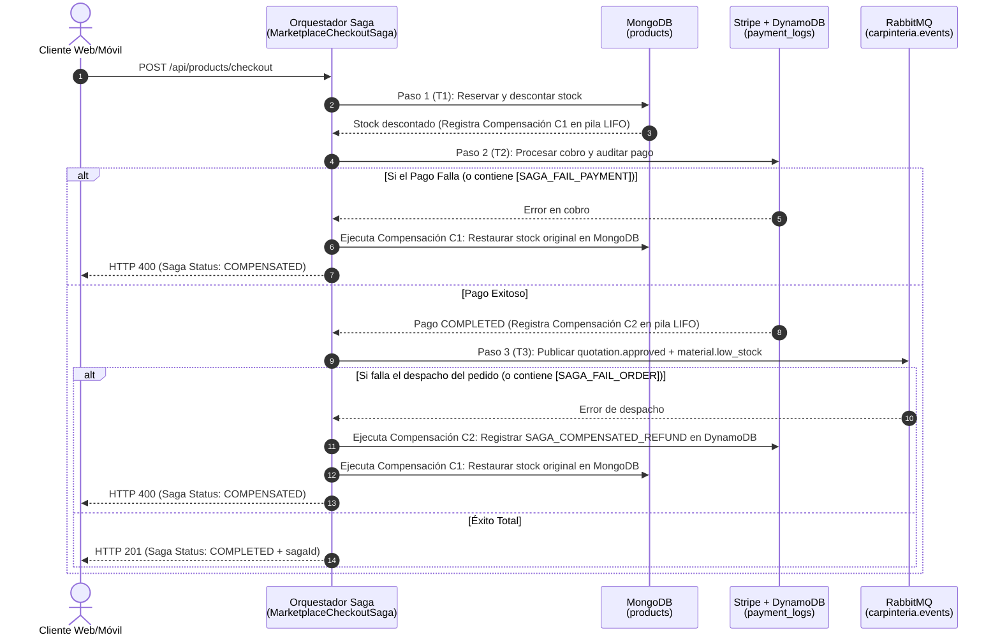

# Implementación de SSO Federado Externo (Google OAuth 2.0 / OIDC) y Patrón de Diseño Saga

---

## 1. SSO Federado Externo con Google (`OAuth 2.0 / OpenID Connect`)

### 1.1 Arquitectura Implementada
Se implementó el flujo **Authorization Code + OIDC** en `Backend2-NestJS-Gateway` y los botones **"Continuar con Google"** en los 3 Frontends Web (`React Portal`, `Angular Admin`, `Svelte Taller`):

1. **Inicio del Flujo (`GET /auth/google`):**
   - Ubicación: [`AuthController.googleAuth()`](../Backend2-NestJS-Gateway/src/auth/auth.controller.ts)
   - Si las variables `GOOGLE_CLIENT_ID` y `GOOGLE_CLIENT_SECRET` están configuradas en el archivo `.env` del Gateway, redirige (`HTTP 302`) directamente al servidor de autorización oficial de Google (`https://accounts.google.com/o/oauth2/v2/auth`) solicitando los scopes `openid email profile`.
   - Si no están configuradas aún en `.env` (o si se pasa `?chooser=1`), despliega el **Selector de Cuentas Federado OIDC de Google** integrado en el Gateway, permitiendo elegir cuentas reales registradas (`Cliente`, `Cliente VIP`, `Carpintero`, `Administrador`) o ingresar cualquier correo `@gmail.com` en vivo durante la defensa sin depender de certificados externos de Google Cloud Console.

2. **Callback y Aprovisionamiento Automático (`GET /auth/google/callback`):**
   - Ubicación: [`AuthController.googleCallback()`](../Backend2-NestJS-Gateway/src/auth/auth.controller.ts) y [`AuthService.loginWithGoogleProfile()`](../Backend2-NestJS-Gateway/src/auth/auth.service.ts)
   - Intercambia el código OAuth 2.0 en `https://oauth2.googleapis.com/token` y obtiene el perfil verificado desde `https://www.googleapis.com/oauth2/v3/userinfo` (o recibe el perfil federado del selector OIDC).
   - **Auto-Provisioning Inteligente (JIT - Just-In-Time Provisioning):**
     - Si el correo ya existe en Redis (`UsersService`), recupera su rol (`ADMIN`, `CARPENTER` o `CLIENT`).
     - Si no existe en Redis, consulta `Backend1-Java-Negocio` (`PostgreSQL`) vía GraphQL para verificar si el correo pertenece a un Carpintero o Cliente previamente registrado por el Administrador.
     - Si es un usuario nuevo, crea automáticamente su cuenta `CLIENT` en Redis y su ficha de cliente en `PostgreSQL`, emitiendo el **JWT Único (`HS256`)** y redirigiendo al Frontend (`?token=<jwt>&email=<email>&sso=google`).

---

## 2. ¿En qué parte del sistema se aplica e implementa el Patrón de Diseño Saga?

En una arquitectura de microservicios con **Database-per-Service** (`MongoDB`, `DynamoDB`, `PostgreSQL`, `SQLite`), una operación de negocio que modifica datos en múltiples bases de datos **no puede usar una transacción ACID local (`BEGIN / COMMIT / ROLLBACK`) ni un bloqueo distribuido `2PC` (Two-Phase Commit)**.

El **Patrón de Diseño Saga** resuelve este problema dividiendo la transacción transversal en una secuencia de **transacciones locales ($T_1, T_2, T_3$)**, donde cada paso tiene asociada una **Transacción de Compensación ($C_1, C_2$)** que deshace semánticamente el efecto de $T_i$ si un paso posterior falla.

En **Carpintería El Roble** existen **dos tipos de Saga**:

### 2.1 Saga Basada en Orquestación (`MarketplaceCheckoutSaga`) — Implementación Explícita con Rollback
* **Ubicación en código:** [`MarketplaceCheckoutSaga`](../Backend2-NestJS-Gateway/src/application/saga/marketplace-checkout.saga.ts) inyectada en [`ProductController.checkout()`](../Backend2-NestJS-Gateway/src/infrastructure/adapters/inbound/rest/product.controller.ts).
* **Caso de Uso:** Compra directa en el **Marketplace** (`POST /api/products/checkout`), donde en una sola operación se deben afectar 4 motores de datos distintos:
  1. **$T_1$ (`RESERVE_STOCK` en MongoDB):** Valida disponibilidad y descuenta el stock de los muebles comprados en `MongoProductRepository`.
     - **Compensación $C_1$ (`CompensateStock`):** Si falla el pago o el despacho del pedido, restaura exactamente el `previousStock` de cada mueble en `MongoDB`.
  2. **$T_2$ (`PROCESS_PAYMENT` en Stripe + DynamoDB + RabbitMQ):** Cobra la tarjeta mediante `ProcessPaymentHandler`, registra `PAYMENT_COMPLETED` en `DynamoDB` (`payment_logs`) y dispara la generación del recibo PDF en `Backend4-PHP-Facturacion`.
     - **Compensación $C_2$ (`CompensatePayment`):** Si falla el paso 3, registra un asiento inverso `SAGA_COMPENSATED_REFUND` por `-totalAmount` en `DynamoDB` (`payment_logs`).
  3. **$T_3$ (`DISPATCH_PRODUCTION_ORDER` hacia RabbitMQ → Java PostgreSQL):** Publica el evento `quotation.approved` (`paid: true`) para que `Backend1-Java-Negocio` cree el Pedido en `PostgreSQL` en estado `IN_PRODUCTION` con sus 3 pasos de taller y auto-asigne al carpintero.

### 2.2 Cómo inspeccionar y demostrar la Saga en vivo durante la defensa
1. **Endpoint de Auditoría de Sagas en Vivo:**
   - `GET https://api.ramio.tech/api/products/sagas`
   - Devuelve el historial JSON de todas las Sagas ejecutadas (`sagaId`, `status: COMPLETED | COMPENSATED`, `steps[]` y `compensations[]`).
2. **Prueba de Rollback / Compensación en Vivo:**
   - Si al comprar en el Marketplace escribes en el campo **Notas de entrega**:
     - `[SAGA_FAIL_PAYMENT]`: La Saga ejecutará el Paso 1 (descontará stock en MongoDB), fallará en el Paso 2 y ejecutará automáticamente la **Compensación $C_1$** restaurando el stock en MongoDB (`status: COMPENSATED`).
     - `[SAGA_FAIL_ORDER]`: La Saga ejecutará el Paso 1 y el Paso 2, fallará en el Paso 3 y ejecutará en orden inverso (`LIFO`) la **Compensación $C_2$** (reembolso en DynamoDB) y la **Compensación $C_1$** (restauración de stock en MongoDB).
